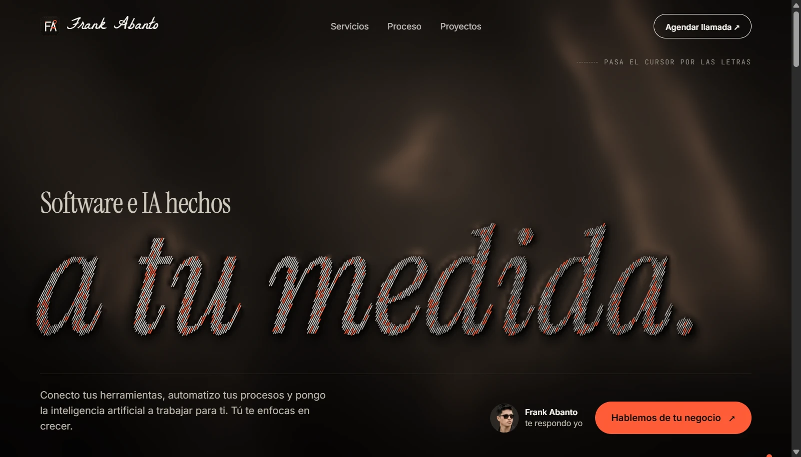

<div align="center">

  

  # Frank Abanto — Software e IA a Medida

  **Portafolio web minimalista, de alto rendimiento y experiencia interactiva artesanal.**

  [](https://frank-abanto.pages.dev)
  [](https://frank-abanto.pages.dev)
  [-success?style=flat-square)](https://frank-abanto.pages.dev)
  [](https://frank-abanto.pages.dev)

  <br />

  <a href="https://frank-abanto.pages.dev" target="_blank" rel="noopener noreferrer">
    
  </a>

</div>

---

## 📌 Resumen

Sitio web estático de arquitectura ultra ligera (**un solo archivo HTML**, sin compiladores ni dependencias externas), diseñado bajo el concepto de **sastrería digital**: soluciones de software, automatizaciones y agentes de inteligencia artificial construidos a la medida exacta de cada negocio.

🌐 **Sitio en vivo:** [frank-abanto.pages.dev](https://frank-abanto.pages.dev)

---

## ✨ Características Principales

- **Hero Artesanal en WebGL & Canvas:** Titular interactivo bordado con física de puntadas dinámicas y fondo de seda en WebGL sensible al cursor (con auto-adaptación para dispositivos lentos).
- **Sincronización Automática con GitHub:** Consulta la API pública de `@FrankUsqAbant` para listar en tiempo real proyectos etiquetados con `portfolio` y despliegue activo.
- **Carrusel Inteligente:** Desplazamiento táctil y arrastre con mouse, pausa automática por interacción, cambio de pestaña o accesibilidad (`prefers-reduced-motion`).
- **Seguridad y Accesibilidad:** Enlaces externos con aislamiento de seguridad (`rel="noopener noreferrer"`), encabezados HTTP endurecidos (`_headers`) y navegación accesible por teclado.
- **Reserva Directa:** Integración sin fricción con Cal.com para agendar llamadas de diagnóstico.
- **Rendimiento Máximo:** Carga instantánea, recursos vectoriales en SVG y tipografías optimizadas.

---

## 📂 Estructura del Repositorio

```text
├── index.html            # Aplicación completa (HTML, CSS y JavaScript puro)
├── logo.svg              # Isotipo / logotipo vectorial de marca
├── favicon.svg           # Favicon SVG escalable y ligero
├── frank-avatar.webp     # Fotografía de perfil optimizada
├── hero-preview.webp     # Captura de alta resolución del Hero
├── _headers              # Cabeceras de seguridad y políticas de caché (Cloudflare)
└── proyectos/            # Capturas locales de respaldo para proyectos
```

---

## 🚀 Inicio Rápido (Local)

Para previsualizar localmente sin necesidad de configurar entornos complejos:

```bash
# Iniciar servidor estático ligero
npx serve .
```

> **Tip:** Puedes probar la versión sin shaders WebGL agregando `?sinseda` en la URL (ideal para pruebas en equipos con bajo rendimiento gráfico).

---

## 🚢 Despliegue en Producción

El proyecto está configurado para desplegarse instantáneamente en **Cloudflare Pages**:

```bash
# 1. Iniciar sesión en Cloudflare (si es necesario)
npx wrangler login

# 2. Desplegar carpeta actual en Cloudflare Pages
npx wrangler pages deploy . --project-name frank-abanto --branch main
```

---

## 🛠️ Tecnologías

- **Core:** HTML5 Semántico, CSS3 Moderno (Custom Properties, CSS Grid, Fluid Typography).
- **Gráficos & Efectos:** Canvas 2D API + Shaders WebGL Fragment.
- **Fuentes:** *Instrument Serif*, *Inter*, *JetBrains Mono* y *La Belle Aurore* (Google Fonts).
- **Hosting:** Cloudflare Pages (Edge CDN global con compresión Brotli automática).
